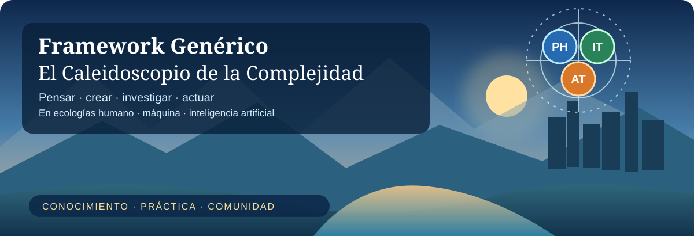
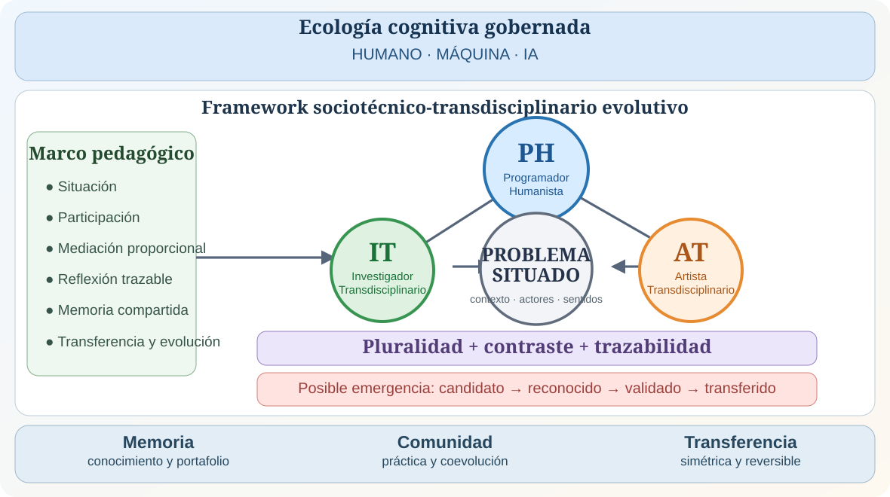
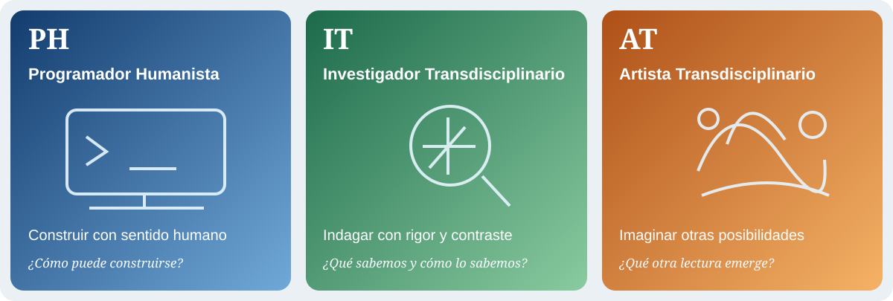
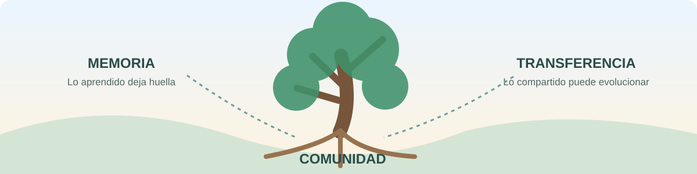

# 🌐 IA en Acción | Educación universitaria e inteligencia artificial generativa
## Investigación situada · Aprendizaje humano · Framework v5.2



**Pensamiento crítico · Ciencias físicas · Mediación responsable · Evidencia · Transferencia**

*Una investigación universitaria que explora qué sucede cuando docentes, estudiantes y herramientas de IA generativa participan en experiencias educativas situadas, y cómo documentar ese trabajo con responsabilidad humana.*

> **El problema es el centro. La tecnología es una mediación. La investigación debe conservar las preguntas, las decisiones, la evidencia y también sus límites.**

Este repositorio constituye el espacio **público y versionado de trabajo estructural** de IA en Acción. Es una implementación del [Framework Genérico v5.2](https://github.com/ricardojuanmorales/framework-proyecto-generico-ia-1), incorporada en modo **INTEGRATE** porque el proyecto ya existía antes de adoptar formalmente su arquitectura. El gate inicial fue aprobado el **15 de octubre de 2026**.

## 🚪 Elige tu puerta de entrada

- 🧭 [Estado de activación](00_CONTROL_MAESTRO/ESTADO_ACTIVACION.md) y [acta humana](00_CONTROL/ACTA_ACTIVACION_INTEGRATE_2026-10-15.md).
- 🗺️ [Mapa estructural del proyecto](02_ARQUITECTURA_CONCEPTUAL/MAPA_ESTRUCTURAL.md).
- 🧩 [Ficha INTEGRATE pública](07_PLANTILLAS_Y_MODELOS/FICHA_INTEGRATE_PUBLICA.md).
- 🔁 [Interoperabilidad y transferencia](10_REPOSITORIOS_Y_FLUJO_TECNICO/INTEROPERABILIDAD.md).
- 📚 [Índice documental y custodia](18_DOCUMENTACION_ACTIVA/INDICE_DOCUMENTAL.md).
- 🛡️ [Privacidad y frontera de publicación](16_SEGURIDAD_PRIVACIDAD_Y_DATOS/NO_PUBLICAR_DATOS_SENSIBLES.md).
- 🚀 [Plan de primera implementación](19_IMPLEMENTACION_Y_DESPLIEGUE/PLAN_INICIAL.md).
- 🗂️ [Deuda de continuidad](18_CONTINUIDAD/DEUDA_PROXIMA_SESION.md).

```yaml
proyecto: IA_en_Accion_V5_2_0
framework: 5.2.0
modo: INTEGRATE
gate_activacion: aprobado
investigacion_empirica: cualitativa_instrumental
publicacion_datos_sensibles: no_autorizada
cotejo_institucional_2C: pendiente
roundtrip_app_entrevista: pendiente_de_prueba
```

## 🧭 ¿Qué investigamos?

La línea empírica doctoral examina la integración situada de la inteligencia artificial generativa en la **enseñanza universitaria de las ciencias físicas en Puerto Rico**, atendiendo a mediación, andamiaje, autonomía, razonamiento, pensamiento crítico y producción de evidencia educativa.

En paralelo existe una **línea metodológica diferenciada**: examinar si la activación y continuidad de una implementación del Framework pueden realizarse tanto desde la aplicación como desde la entrevista con acompañamiento experto N3/N4, preservando su significado y su procedencia.

| Plano | Centro de atención | Límite |
|---|---|---|
| **A · Investigación doctoral** | Docente · estudiante · IA, experiencia educativa y análisis cualitativo | No confundir investigación cualitativa con prueba causal de eficacia |
| **B · Investigación metodológica** | Framework · experto humano · aplicación, contratos y transferencia reversible | No presentar compatibilidad propuesta como equivalencia demostrada |

**Las dos líneas se relacionan intelectualmente, pero no comparten automáticamente consentimientos, datos ni autorizaciones.**

## 🧬 Figura 1 · Del problema a las lentes del Framework



*Ilustración conceptual tomada del repositorio maestro del Framework v5.2; es una referencia estructural y no representa un hallazgo empírico de IA en Acción.*

La aplicación situada parte de un problema relevante y moviliza las capacidades que necesita. No se activan lentes por llenar casillas.

## 🔭 Tres lentes para un trabajo transdisciplinario



| Lente | Función situada | Pregunta orientadora |
|---|---|---|
| 🔵 **PH · Programador Humanista** | Aplicaciones, infraestructura, accesibilidad, privacidad, portabilidad | ¿Cómo construir responsablemente? |
| 🟢 **IT · Investigador Transdisciplinario** | Preguntas, métodos, evidencia, procedencia y límites | ¿Qué sabemos y cómo lo justificamos? |
| 🟠 **AT · Artista Transdisciplinario** | Experiencias, representaciones, creación y mediación cultural | ¿Qué nuevas formas de comprender permiten actuar? |

Las tres lentes operan en el estudio metodológico. **PH/IT/AT no sustituyen la tríada docente–estudiante–IA** del estudio doctoral. El **Caleidoscopio** es una posible emergencia entre perspectivas, no un cuarto perfil.

## 🎓 De la investigación a aplicaciones humanas

El objetivo operativo es transformar contenidos en experiencias **lúdicas, interactivas, accesibles y trazables**, sin reducirlas a automatización ni a extracción de datos.

```text
problema educativo verificable
  → especificación SDD mínima
  → arquitectura y diseño humano
  → aplicación modular
  → prueba y validación
  → portafolio privado y reflexión
  → transferencia portable
  → posible mejora tras gate humano
```

Dos experiencias documentadas informan este trayecto:

- **[AI StoryLab 1](https://github.com/ricardojuanmorales/ai-storylab-1):** referencia para desarrollo guiado por especificaciones (SDD), riesgos, pruebas, consentimiento y revisión humana, aplicado proporcionalmente.
- **[Materia Mundi](https://github.com/ricardojuanmorales/materia-mundi-101):** referencia para portal común con aplicaciones independientes en subrutas y despliegue verificado mediante GitHub Actions.

**Marco Mundi** permanece como metodología especializada invocable cuando resulte pertinente, sin añadir un segundo régimen de gobernanza a toda aplicación.

## 🧳 Portafolio, memoria y privacidad

El portafolio es una memoria **situada, local-first y privada por defecto**. Puede reunir reflexiones, artefactos, preguntas, decisiones y avances. Compartir requiere selección consciente y autorización situada; publicar el código de una aplicación no significa publicar el portafolio de quien la utiliza.



Nuestro criterio de interoperabilidad exige **exportar → continuar fuera → importar** conservando identidad de origen y linaje, procedencia, decisiones y significado material. Esa equivalencia **todavía debe probarse** para esta implementación.

## 🗂️ Cartapacios 00–21 + 99

La macroestructura es el **cuerpo documental lógico** compartido con el Framework. Su activación es proporcional; la presencia de una carpeta no demuestra que un campo esté investigado, validado o terminado.

| Ruta | Función principal |
|---|---|
| [00](00_CONTROL_MAESTRO/) · [01](01_FUNDAMENTO_FILOSOFICO/) · [02](02_ARQUITECTURA_CONCEPTUAL/) | Gobierno, fundamentos y arquitectura |
| [03](03_METODOLOGIA_Y_FLUJO_DE_TRABAJO/) · [04](04_GOBERNANZA_ETICA_Y_RIESGOS/) · [05](05_COMPETENCIAS_Y_PERFILES/) | Métodos, ética y lentes |
| [06](06_PASTILLAS_MODULARES/) · [07](07_PLANTILLAS_Y_MODELOS/) · [08](08_CURSOS_PROGRAMAS_Y_TRAYECTORIAS/) | Módulos, plantillas y educación |
| [09](09_IA_AGENTES_Y_COPILOTOS/) · [10](10_REPOSITORIOS_Y_FLUJO_TECNICO/) · [11](11_MULTIMODALIDAD_Y_PUBLICACION/) | IA, datos, portabilidad y publicación |
| [12](12_DISENO_INSTRUCCIONAL_UNIVERSAL/) · [13](13_INVESTIGACION_Y_EVIDENCIA/) · [14](14_COMUNIDAD_TRANSFERENCIA_Y_ESCALAMIENTO/) | Diseño inclusivo, evidencia y transferencia |
| [15](15_EVALUACION_CALIDAD_Y_AUDITORIA/) · [16](16_SEGURIDAD_PRIVACIDAD_Y_DATOS/) · [17](17_INTERNACIONALIZACION_LOCALIZACION/) | Evaluación, privacidad y contexto |
| [18](18_DOCUMENTACION_ACTIVA/) · [19](19_IMPLEMENTACION_Y_DESPLIEGUE/) · [20](20_MANTENIMIENTO_Y_EVOLUCION/) | Documentación, implementación y evolución |
| [21](21_WIKI_DOCUMENTACION_HUMANA/) · [99](99_ARCHIVO_HISTORICO/) | Orientación humana y archivo de versiones |

## 📖 Documentación: qué puedes ver y dónde

**En GitHub** viven el README, decisiones estructurales publicables, acta, ficha, índices, límites de tratamiento de datos y planes de implementación. **En el cartapacio local protegido** permanecen el compendio histórico completo, los documentos extensos, versiones Word/PDF, propuestas, instrumentos y archivos que pueden contener información sensible.

Consulta el [índice de documentos y custodia](18_DOCUMENTACION_ACTIVA/INDICE_DOCUMENTAL.md). El README anterior está preservado en [99_ARCHIVO_HISTORICO](99_ARCHIVO_HISTORICO/README_HISTORICO_2026-10-16_PRE_REDISENO.md).

> **Repositorio público ≠ depósito de evidencias humanas identificables.** El cotejo institucional 2C sigue pendiente. No cargar aquí entrevistas, consentimientos, grabaciones, documentos privados ni producciones estudiantiles sin permisos y revisión pertinentes.

## 🧭 Dónde estamos y qué viene

| Momento | Estado |
|---|---|
| Concertación y entrevista inicial | Completadas |
| Arquitectura Fundacional AF-0.1 | Aprobada |
| Gate **INTEGRATE** | **Aprobado** para trabajo conceptual y técnico no sensible |
| Cotejo institucional 2C | Pendiente |
| Primera aplicación educativa/investigativa | Necesidad por seleccionar y especificar |
| Prueba de transferencia app ↔ entrevista | Pendiente |
| Consolidación y transferencia de aprendizajes | Pendiente |

**Próximo paso:** seleccionar una necesidad educativa o investigativa verificable y preparar su especificación SDD breve. Las aplicaciones, sus pruebas y eventuales despliegues se autorizan mediante gates propios.

---

## 🌱 Una invitación a investigar

Este proyecto no busca producir más documentación por sí misma. Busca que el conocimiento se traduzca en experiencias que las personas puedan comprender, explorar, discutir y mejorar, conservando el derecho a reflexionar privadamente, cuestionar a la IA y reabrir decisiones.

**Primero la pregunta humana. Luego la mediación técnica. Siempre la evidencia y sus límites.**

### 🎨 Procedencia visual

Los cuatro archivos SVG de este README son **copias de los recursos editoriales del [Framework Genérico v5.2](https://github.com/ricardojuanmorales/framework-proyecto-generico-ia-1)**, conservadas en `21_WIKI_DOCUMENTACION_HUMANA/Recursos_Visuales/README_IA_EN_ACCION/`. El diagrama de arquitectura es una adaptación editorial vinculada a la ponencia *El Caleidoscopio de la Complejidad*, atribuida en el repositorio maestro a Ricardo Juan Morales De Jesús y Manuel de J. Reyes Guzmán. Las imágenes explican relaciones conceptuales; **no constituyen resultados empíricos de esta investigación**. La procedencia visual no transfiere por sí sola autoría académica ni valida resultados.
